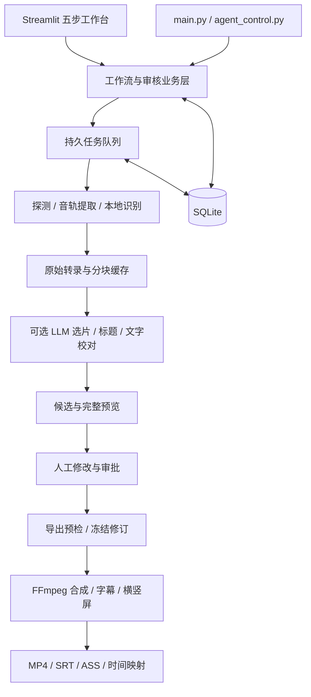

# 架构与数据流

项目采用直接运行源码的 Python 应用结构。保留 `core/`、`ui/`、`storage/` 和现有入口，避免为了目录规范破坏路径、后台任务和历史数据兼容性。

## 模块职责

| 目录 / 模块 | 职责 |
| --- | --- |
| `main.py` | CLI 参数、诊断、项目与任务控制 |
| `ui/app.py`、`ui/workbench.py` | 项目入口、五步工作台、状态和人工交互 |
| `core/config.py`、`asr_settings.py`、`llm_settings.py` | 配置读取、验证及个人设置 |
| `core/video_input.py`、`audio_extract.py`、`source_sequence.py` | 素材探测、规范音轨及顺序拼接 |
| `core/transcriber.py`、`local_asr.py`、`gpu_runtime.py` | 本地识别、分块复用、GPU 运行库发现与设备选择 |
| `core/clip_selector.py`、`editing.py`、`timeline.py` | 候选、剪辑形式与时间轴 |
| `core/workflow.py`、`workflow_quality.py` | 项目方案、审核、修订及导出约束 |
| `core/subtitle*.py`、`transcript_refine.py` | 字幕解析、校对、人工修改及样式 |
| `core/audio_sync.py`、`semantic_sync.py`、`visual_sync.py` | 双路偏移建议与对照 |
| `core/compositor.py`、`*_renderer.py` | 预览、画中画、字幕和正式渲染 |
| `core/jobs.py`、`scripts/job_worker.py` | 后台持久任务、取消、重试和恢复 |
| `core/export_center.py`、`deliveries.py`、`production.py` | 跨项目导出、本地生产与可选发布交付 |
| `core/local_api.py`、`automation_client.py`、`publisher_client.py` | 本机配对 API 与外部服务边界 |
| `storage/*.py` | SQLite 模型、项目、方案、双路和工作台数据访问 |
| `core/releases.py`、`scripts/package_source.py` | 本地源码检查点及不含运行数据的交付包 |

## 保留的不变量

1. 原始转录、人工字幕与自动校对结果分别保存；失败状态不得伪装为完成。
2. AI 分数与人工星级分别保存。重新分析不能覆盖人工修改与审批。
3. 预览包含完整成品区间；正式导出只接收通过审批且满足校验的快照。
4. 修改范围或方案会产生修订及字幕复核要求，旧成品作为历史保留。
5. 双路偏移定义为“主播时间 = 比赛时间 + 偏移”。固定偏移不能修复缺录或变速漂移。
6. 本地导出与平台发布是不同操作；外部发布服务失败不应要求重新剪辑。

旧 clips / plans 和新工作台工作流并存，因此 CLI `export`、`plan-export`、`workflow-export` 对应不同记录层。维护时应先识别对象来源，再调用相应业务接口。
